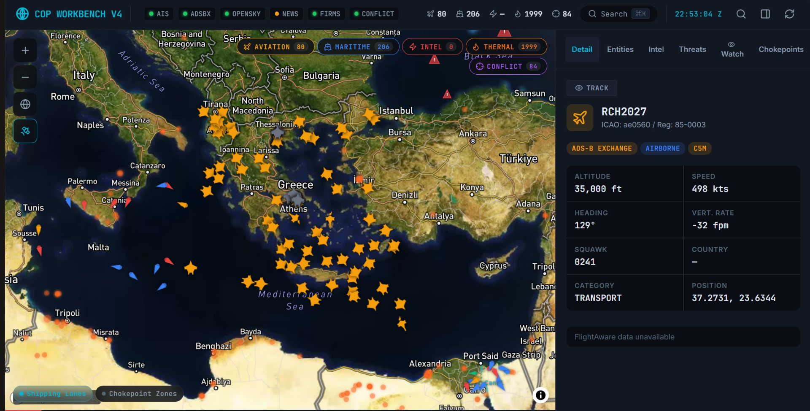
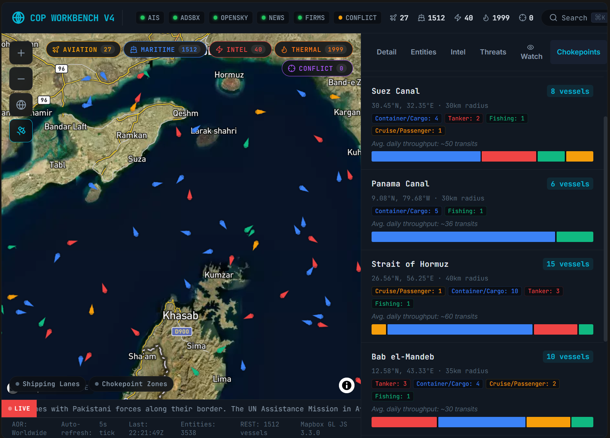

# Satellite challenge

Satellite Challenge is a tracking dashboard for ships and aircraft. It pairs replay controls, shared API contracts and entity-focused review so the ingest path and operator surface can be reviewed together.




- **Status:** Active prototype
- **Stack:** TypeScript, Express, React, shared types, map UI
- **Problem:** Live maritime and aviation feeds are hard to interpret without shared contracts, replay and a readable review surface.

## Why it matters

- It is the strongest full-stack operator dashboard in the current public set.
- It keeps ingestion, replay and UI decisions visible instead of splitting them across disconnected repos.
- It shows how shared contracts make a live map interface more reliable to evolve.

## Repository layout

- `apps/api`: feed polling, replay buffer, normalization and enrichment
- `apps/web`: map UI, entity panel, status bar and replay controls
- `packages/shared-types`: contracts shared by the API and web app

## Run locally

Copy `.env.example` to `.env` and set the providers you want to use:

- `MAPBOX_ACCESS_TOKEN`
- `AISSTREAM_API_KEY`
- `FLIGHTAWARE_API_KEY`
- optional `OPENSKY_USERNAME`
- optional `OPENSKY_PASSWORD`

```bash
npm install
npm run dev
```

- API: `http://localhost:4000`
- Web: `http://localhost:5173`

## Verification

```bash
npm test
npm run test:e2e -w @sat/web
```

## What to read next

1. `docs/landing.md` for the short walkthrough
2. `docs/architecture.md` for ingest and replay design
3. `apps/api` for the feed path
4. `apps/web` for the operator workflow
